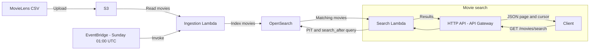

# OpenSearch Movie Search Service

## Overview

The OpenSearch Movie Search Service provides movie title search with typo
tolerance, exact genre filtering, and JSON pagination through API Gateway and
Lambda. It uses a provisioned OpenSearch domain. Search-as-you-type suggestions
(autocomplete) are planned.

The project is being developed and tested locally using Floci.

The service uses a MovieLens dataset stored in Amazon S3. An ingestion Lambda processes the dataset and indexes movie records into Amazon OpenSearch.

A search Lambda queries OpenSearch and returns ranked JSON movie results through an HTTP API. Title search tolerates typos, and an optional exact genre filter narrows results.

The architecture is:



The stack schedules ingestion every **Sunday at 1:00 AM UTC**.
Each run creates the `movies` index if needed and writes movie IDs, titles, and
genres. Repeated runs update the same movie IDs without adding duplicates; they
do not remove movies missing from the CSV. Uploading a file does not trigger a run.

OpenSearch uses version 2.11, one `t3.small.search` node, and 10 GiB of storage.
The ingestion Lambda uses Python 3.13, 512 MB of memory, and a 15-minute timeout.
The search Lambda uses Python 3.13, 512 MB of memory, and a 25-second timeout.
API Gateway invokes it through `GET /movies/search`. Autocomplete remains planned.

## Run locally

Complete the [project setup](../../README.md) first, including CDK bootstrap.
Run these commands from the repository root with Docker available. Configure
the Floci server with real OpenSearch mode (`FLOCI_SERVICES_OPENSEARCH_MOCK=false`)
before creating the domain; this setting belongs to the emulator process.

```bash
# Start the configured local emulator.
floci start

# Configure this terminal to use Floci credentials and endpoints.
eval "$(floci env)"
export AWS_ENDPOINT_URL_S3=http://s3.localhost.floci.io:4566

# Check whether the movies-search domain already exists.
aws opensearch describe-domain --domain-name movies-search
```

Floci can report a successful stack deployment without creating the OpenSearch
domain. If `movies-search` is missing, create it once through the API:

```bash
# Create the local domain only if the previous check reports it is missing.
aws opensearch create-domain \
  --domain-name movies-search \
  --engine-version OpenSearch_2.11 \
  --cluster-config InstanceType=t3.small.search,InstanceCount=1 \
  --ebs-options EBSEnabled=true,VolumeType=gp2,VolumeSize=10
```

Repeat this check until `Created` is `true`, `Processing` is `false`, and `Endpoint` is populated:

```bash
# Wait for the domain to finish provisioning and expose an endpoint.
aws opensearch describe-domain \
  --domain-name movies-search \
  --query 'DomainStatus.{Created:Created,Processing:Processing,Endpoint:Endpoint}'
```

Deploy the stack, then upload a MovieLens CSV with `movieId`, `title`, and `genres`
columns. Replace `./movies.csv` with your file path:

```bash
# Deploy the ingestion schedule, Lambda functions, and search API.
npx cdklocal deploy OpenSearchServiceStack

# Upload the source CSV to the key read by the ingestion Lambda.
aws s3 cp ./movies.csv s3://movies-data-bucket/raw/movies.csv
```

The weekly schedule takes effect after deployment. Keep Floci and OpenSearch
running at the scheduled time. The manually created domain is managed separately
from the stack. See [Floci's CloudFormation support](https://github.com/floci-io/floci/blob/main/docs/services/cloudformation.md).

## Check ingestion

Run ingestion immediately without waiting for Sunday:

```bash
# Invoke ingestion synchronously and save its response; allow up to 15 minutes.
aws lambda invoke \
  --function-name opensearch-stack-ingestion-lambda \
  --cli-read-timeout 900 \
  /tmp/opensearch-ingestion-result.json

# Inspect the returned ingestion result.
cat /tmp/opensearch-ingestion-result.json
```

Confirm there is no `FunctionError` and the response body reports a positive
`indexed` count with `errors: 0`.

Uploading the CSV alone does not invoke ingestion. After a successful run, use
[the search API](#search-movies-through-the-api) or
[direct OpenSearch checks](#manually-search-and-verify-movie-data) to inspect the
indexed data. Build and unit-test commands are in
[Test the search implementation](#test-the-search-implementation).

## Search movies through the API

The demo API requires no authentication. It would also be publicly accessible if
this stack were deployed to AWS. No browser CORS configuration is included.

`GET /movies/search` accepts:

| Parameter | Behavior |
| --- | --- |
| `q` | Title text, trimmed, at most 200 characters. All words must match, with `AUTO` typo tolerance. |
| `genre` | Exact, case-sensitive genre, trimmed, at most 100 characters, such as `Comedy`. |
| `limit` | Integer page size from 1 to 100; defaults to 20. |
| `cursor` | Opaque continuation token from the previous response. |
| `paginate` | `true` by default. Set `false` for one live page without a PIT snapshot or continuation cursor; cannot be combined with `cursor`. |

Supply at least one nonblank `q` or `genre`. Unknown or repeated parameters are
rejected. Title results sort by relevance, then movie ID; genre-only results sort
by movie ID. Typo tolerance operates on title words. It can also return other
similar titles, so an exact spelling and a misspelled query can have different
match counts. Semantic similarity and autocomplete are not implemented.

After completing setup and ingestion above, find the local URL:

```bash
# Configure the AWS CLI and CDK for the running local Floci instance.
eval "$(floci env)"
export AWS_ENDPOINT_URL_S3=http://s3.localhost.floci.io:4566

# Find this API by its configured name.
MOVIES_API_ID=$(aws apigatewayv2 get-apis \
  --query "Items[?Name=='movies-search-api'].ApiId | [0]" --output text)

# Use Floci's host-accessible API route; escape $default so the shell preserves it.
MOVIES_SEARCH_URL="http://localhost:4566/execute-api/${MOVIES_API_ID}/\$default/movies/search"
```

If API discovery returns `None`, confirm that `OpenSearchServiceStack` is deployed
and your shell uses the Floci environment.

CloudFormation also outputs `MoviesSearchApiId` and `MoviesSearchUrl`. On AWS,
use `MoviesSearchUrl` directly. Locally, use the Floci URL above. The Lambda
resolves the internal OpenSearch address itself; your terminal calls API Gateway.

```bash
# Search for a title; --data-urlencode safely encodes spaces and special characters.
curl -sS --max-time 30 --get "$MOVIES_SEARCH_URL" \
  --data-urlencode 'q=Toy Story'

# Verify typo tolerance: stroy should match story.
curl -sS --max-time 30 --get "$MOVIES_SEARCH_URL" \
  --data-urlencode 'q=toy stroy'

# Combine title search with an exact genre filter.
curl -sS --max-time 30 --get "$MOVIES_SEARCH_URL" \
  --data-urlencode 'q=Toy Story' --data-urlencode 'genre=Comedy'

# Search by genre alone and return up to 10 movies.
curl -sS --max-time 30 --get "$MOVIES_SEARCH_URL" \
  --data-urlencode 'genre=Comedy' --data-urlencode 'limit=10'

# Fetch a small first page and save its JSON response.
curl -sS --max-time 30 --get "$MOVIES_SEARCH_URL" \
  --data-urlencode 'q=Toy Story' --data-urlencode 'limit=2' \
  -o /tmp/movies-page.json

# Extract the next cursor using Python; an empty string means there is no next page.
MOVIES_CURSOR=$(python3 -c 'import json; print(json.load(open("/tmp/movies-page.json"))["nextCursor"] or "")')

# Request the next page with the same q, genre (if used), and limit.
if [ -n "$MOVIES_CURSOR" ]; then
  curl -sS --max-time 30 --get "$MOVIES_SEARCH_URL" \
    --data-urlencode 'q=Toy Story' --data-urlencode 'limit=2' \
    --data-urlencode "cursor=$MOVIES_CURSOR"
fi

# Inspect the JSON validation error and HTTP 400 status for a missing search.
curl -sS -i --max-time 30 "$MOVIES_SEARCH_URL"
```

An illustrative successful response for a dataset with one matching movie is
shown below. Actual movies and totals depend on your CSV and query.

```json
{
  "query": "toy stroy",
  "genre": null,
  "total": 1,
  "movies": [
    {
      "movieId": 1,
      "title": "Toy Story (1995)",
      "genres": ["Adventure", "Animation", "Children", "Comedy", "Fantasy"]
    }
  ],
  "nextCursor": null
}
```

| Response field | Meaning |
| --- | --- |
| `query` | Trimmed title query, or `null` for a genre-only search. |
| `genre` | Trimmed genre filter, or `null` when omitted. |
| `total` | Exact match count across all pages of this search snapshot. |
| `movies` | Current page, containing only `movieId`, `title`, and the `genres` array. |
| `nextCursor` | Token to pass on the next request, or `null` after the final page. |

No matches returns HTTP 200 with `total: 0`, `movies: []`, and
`nextCursor: null`. A page can contain fewer movies than `total` because `limit`
controls page size.

Repeat the search with each returned cursor until `nextCursor` is `null` to
retrieve all matches, including searches exceeding 10,000 results. Keep the
normalized search parameters and page size unchanged. Pagination uses an
OpenSearch point-in-time (PIT) snapshot created on the first request. Later pages
use that snapshot and `search_after`, so ingestion changes do not shift the
results. Each page renews the snapshot for five minutes. The final page attempts
to close it; abandoned snapshots and any left by a cleanup failure expire
automatically. Closing a snapshot releases its resources and preserves the movies.

Treat cursors as opaque continuation state and send them with `--data-urlencode`.
They do not authenticate callers. A cursor whose snapshot has expired or has
already been closed returns HTTP 410; restart the search without a cursor to
obtain a fresh snapshot.

Errors use this JSON shape:

```json
{
  "error": {
    "code": "INVALID_REQUEST",
    "message": "Provide q or genre."
  }
}
```

| HTTP status | Meaning |
| --- | --- |
| 400 | Invalid parameters, malformed cursor, or changed search parameters. |
| 410 | Snapshot expired or is no longer available; restart the search. |
| 503 | OpenSearch/index unavailable or incomplete shard results. |
| 504 | Search timed out; retry. |
| 500 | Unexpected internal failure. |

The Lambda logs request IDs, elapsed time, returned counts, and failures. Clients
receive JSON errors without internal exception details.

## Local movie-search page

The demo page searches while you type and supports an optional genre filter.
It shows the first 20 matches and the total match count, without pagination or
autocomplete. A small Python standard-library server serves the HTML and forwards
search requests to the existing API, so no browser CORS changes are needed.

After completing setup and ingestion, run from the repository root:

```bash
# Load Floci's environment and discover the deployed movie API.
eval "$(floci env)"
MOVIES_API_ID=$(aws apigatewayv2 get-apis \
  --query "Items[?Name=='movies-search-api'].ApiId | [0]" --output text)
MOVIES_SEARCH_URL="http://localhost:4566/execute-api/${MOVIES_API_ID}/\$default/movies/search"

# Serve the page locally; keep this terminal open.
python3 scripts/opensearch-service/search_demo.py --url "$MOVIES_SEARCH_URL"
```

Open **http://127.0.0.1:8000** in your browser. Try `Toy Story`, `toy stroy`, or
select a genre without entering a title. Clear resets both fields. Searches run
after a 350 ms typing pause; changing the genre or pressing Enter searches
immediately. Requests use `paginate=false` to avoid creating pagination snapshots.

If discovery returns `None`, confirm the stack is deployed and the Floci
environment is loaded. If port 8000 is busy, add `--port 8001` and open
http://127.0.0.1:8001 instead. Stop the server with Ctrl+C. Floci and indexed movie
data must remain available for searches to succeed. No additional dependencies
are required; opening the HTML file directly does not run the proxy.

## Manually search and verify movie data

With Floci and the OpenSearch container running, query OpenSearch directly to
check ingestion and search behavior independently of the HTTP API.

Floci can return an internal Docker endpoint such as `http://172.17.0.5:9200`.
On macOS, that address is not directly reachable from the host when port 9200
is not published, so a host-side `curl` request can hang. Run the queries inside
the OpenSearch container instead. These commands are for the local Floci setup;
an AWS domain may require IAM-signed requests.

Define this helper in your terminal:

```bash
# List running containers and their published ports to locate OpenSearch.
docker ps --format '{{.Names}}\t{{.Ports}}'

# Run curl inside the movies-search container, where localhost:9200 is OpenSearch.
# Limit connection time to 3 seconds and the entire request to 10 seconds.
# Forward all arguments so the helper supports URLs, headers, and query bodies.
os_curl() {
  docker exec floci-opensearch-movies-search \
    curl -sS --connect-timeout 3 --max-time 10 "$@"
}
```

Check the cluster, index, and stored records:

```bash
# Check cluster health and shard allocation; pretty formats the JSON response.
os_curl 'http://localhost:9200/_cluster/health?pretty'

# Confirm the movies index exists and show its status, document count, and size.
os_curl 'http://localhost:9200/_cat/indices/movies?v'

# Return the exact number of searchable movie documents.
os_curl 'http://localhost:9200/movies/_count?pretty'

# Fetch the movie whose document ID is 1; ingestion uses movieId as the document ID.
# Replace 1 with a movieId from your CSV to compare the indexed record with its row.
os_curl 'http://localhost:9200/movies/_doc/1?pretty'

# Return 10 sample movies, ordered by movieId, and count all matching documents.
os_curl 'http://localhost:9200/movies/_search?pretty' \
  -H 'Content-Type: application/json' \
  -d '{
    "size": 10,
    "track_total_hits": true,
    "query": {"match_all": {}},
    "sort": [{"movieId": "asc"}]
  }'
```

Cluster health should be `green` with this project's single-node index settings
(one primary shard and no replicas). `yellow` means some replicas are unassigned;
`red` means some primary shards are unavailable. Check that `_count` matches the
number of unique movie IDs ingested. Existing IDs are updated on repeated runs,
but movies removed from the CSV remain in the index.

For a document lookup, confirm `found` is `true` and compare `_source.movieId`,
`_source.title`, and `_source.genres` against the CSV. Genres are stored as an
array; `(no genres listed)` becomes an empty array. For search responses, inspect
the records under `hits.hits[*]._source`. `size: 10` limits the returned sample,
while `track_total_hits: true` requests the exact total match count.

Try title search and genre filtering:

```bash
# Search the analyzed title field and return up to 10 results ranked by relevance.
# Replace Toy Story with a title you know is present in your CSV.
os_curl 'http://localhost:9200/movies/_search?pretty' \
  -H 'Content-Type: application/json' \
  -d '{
    "size": 10,
    "query": {
      "match": {"title": "Toy Story"}
    }
  }'

# Find movies containing the exact, case-sensitive Comedy genre.
# genres is mapped as keyword, so use term for an exact genre filter.
os_curl 'http://localhost:9200/movies/_search?pretty' \
  -H 'Content-Type: application/json' \
  -d '{
    "size": 10,
    "query": {
      "term": {"genres": "Comedy"}
    }
  }'
```

The title search should return relevant movies from your dataset. Every result
from the genre query should contain `Comedy` in its `genres` array. Compare a few
known movies with the source CSV to verify field values as well as search behavior.

## OpenSearch permissions

The policies in [the stack definition](../../lib/opensearch-service-stack.ts)
are attached to the search Lambda's execution role. Each statement grants an
operation (`actions`) on a domain or API path (`resources`). `domainArn` identifies
the OpenSearch domain; appending a path limits the permission to that endpoint.

| IAM action | Resource suffix | Request and purpose |
| --- | --- | --- |
| `es:DescribeDomain` | Domain ARN itself | Discover the domain endpoint before connecting. |
| `es:ESHttpPost` | `/movies/_search/point_in_time` | Create a PIT snapshot of the movies index. |
| `es:ESHttpPost` | `/_search` | Search the PIT and fetch subsequent result pages. |
| `es:ESHttpDelete` | `/_search/point_in_time` | Close the PIT after the last page to free snapshot resources. |

`/_search` and `/_search/point_in_time` are root endpoints under the domain URL.
The PIT ID in the request body identifies the index snapshot, so subsequent
search requests do not put `/movies` in the URL. The DELETE permission closes
snapshots; it does not grant deletion of movie documents or the movies index.

These permissions restrict HTTP methods and paths. IAM's permission for the root
`/_search` endpoint is not itself restricted to the movies index; the Lambda
creates its PITs from `movies`. Stronger index-level authorization would require
additional OpenSearch access controls.

The Lambda resolves the endpoint at runtime because Floci can supply a synthetic
CDK domain endpoint. Connections to local OpenSearch use unsigned HTTP; AWS
OpenSearch connections use verified HTTPS and SigV4 signing. The client is reused
across warm Lambda invocations.

The ingestion Lambda has separate permissions. Before deploying this demo to
AWS, add its missing `es:DescribeDomain`, `es:ESHttpHead`, and root `/_bulk`
permissions. The search-role statements above do not grant permissions to
ingestion. Also review the unauthenticated API, fixed bucket names, and destructive
removal policies described in [Local vs real AWS](../../README.md#local-vs-real-aws).

## Load test the search API

After deployment and successful ingestion, run the search load tester from the
repository root. It uses Python's standard library, with no extra dependencies.
Use the API ID from your current deployment and quote the URL to preserve `$default`:

```bash
MOVIES_SEARCH_URL='http://localhost:4566/execute-api/1c066b0d28/$default/movies/search'

# Start with a small run.
python3 scripts/opensearch-service/load_test.py 100 \
  --workers 5 --url "$MOVIES_SEARCH_URL"

# Increase concurrency and save results for comparison.
python3 scripts/opensearch-service/load_test.py 1000 \
  --workers 20 --url "$MOVIES_SEARCH_URL" --output /tmp/movies-load-results.json

# Run a specific title and genre workload.
python3 scripts/opensearch-service/load_test.py 1000 \
  --workers 40 --url "$MOVIES_SEARCH_URL" \
  --query 'Toy Story' --genre Comedy --limit 10
```

The default workload cycles through 39 searches: 24 title searches (including
typos), 8 genre-only searches, and 7 title-plus-genre searches. Titles include
Toy Story, Star Wars, The Matrix, Jurassic Park, The Godfather, Harry Potter,
and Finding Nemo. Matches depend on the uploaded dataset; absent titles return
successful empty results. `--query` and/or `--genre` select a fixed workload instead.
`--limit` accepts 1–100 (default 20); `--timeout` sets the socket timeout in
seconds (default 30). Workers send their next request after the previous one
finishes, without retries or a fixed request rate.

The summary reports successes, failures, status codes, throughput, average and
p50/p95/p99/max latency, returned movie counts, and errors. HTTP 200 with a valid
search response counts as success, including an empty result. Any failed request
causes exit code 1. Latency includes failed requests and connection setup.

The runner sends `paginate=false`: each request fetches one live page without
creating a PIT snapshot, and `nextCursor` is always `null`. `total` still counts
all matches. Deploy the updated search Lambda before using this runner:

```bash
eval "$(floci env)"
export AWS_ENDPOINT_URL_S3=http://s3.localhost.floci.io:4566
npx cdklocal deploy OpenSearchServiceStack
```

Regular searches retain snapshot pagination by default. Snapshots from earlier
runs expire after five minutes; allow them to expire before testing the updated
runner. The script prints only its startup information and final summary.

### Fix an invalid API ID

If the report URL contains `/execute-api/None/` and every request returns 404,
API discovery did not find the API. Reset the variable using your deployment's
`MoviesSearchApiId` output. For the deployment used in these examples:

```bash
export MOVIES_SEARCH_URL='http://localhost:4566/execute-api/1c066b0d28/$default/movies/search'
curl -sS -i --max-time 30 --get "$MOVIES_SEARCH_URL" \
  --data-urlencode 'q=Toy Story' --data-urlencode 'paginate=false'
```

Use your current API ID if it changes. The runner rejects `None`, `null`, and
`undefined` path components. Fix routing before measuring search capacity.

### Recorded local results

The expanded 39-query workload completed with pagination disabled:

```bash
python3 scripts/opensearch-service/load_test.py 10000 \
  --workers 15 --url "$MOVIES_SEARCH_URL"
```

| Metric | Result |
| --- | --- |
| Workload | 39 searches: 24 title, 8 genre-only, 7 title-plus-genre |
| Page size / pagination | 20 / disabled (`paginate=false`) |
| Concurrent workers | 15 |
| Requests / successful / failed | 10,000 / 10,000 / 0 |
| HTTP status codes | 10,000 × 200 |
| Elapsed time | 200.967 seconds |
| Throughput | 49.76 requests/second |
| Average latency | 289.67 ms |
| p50 latency | 81.13 ms |
| p95 latency | 279.68 ms |
| p99 latency | 6,520.07 ms |
| Maximum latency | 19,595.69 ms |
| Movies returned across all requests | 132,281 |
| Errors | None |

All requests succeeded, but p99 latency exceeded six seconds. This is an observed
local Floci result for this workload, not a maximum-capacity measurement or an AWS
benchmark. Movie counts include repeated results across requests. The earlier
six-query run at the same request count and concurrency achieved 66.57
requests/second; its different workload prevents a like-for-like comparison.

### Diagnose failed runs

An observed run of the original paginated runner sent 10,000 searches with 15
workers: 244 succeeded, 9,748 returned 503, and 8 timed out in 254.93 seconds.
That is a 2.44% success rate and about 0.96 successful searches/second. The
reported 39.23 requests/second includes failures and is not usable capacity.
The p99 latency was about 9.79 seconds and maximum latency about 30 seconds.

`SEARCH_UNAVAILABLE` is a generic response. Check Lambda exception logs to
distinguish PIT exhaustion, connection failures, missing indices, rejected
searches, and shard failures. The previous runner left multi-page snapshots open;
PIT exhaustion is a possible explanation, not a confirmed diagnosis. OpenSearch
[PIT documentation](https://docs.opensearch.org/2.11/search-plugins/searching-data/point-in-time/)
describes their retained resources and inspection APIs.

```bash
aws logs tail /aws/lambda/opensearch-stack-search-lambda --since 15m
docker logs --tail 200 floci-opensearch-movies-search
docker stats --no-stream floci-opensearch-movies-search

# Run inside Docker because Floci's internal endpoint may be unreachable from macOS.
docker exec floci-opensearch-movies-search curl -sS \
  'http://localhost:9200/_cluster/health?pretty'
docker exec floci-opensearch-movies-search curl -sS \
  'http://localhost:9200/_nodes/stats/jvm,process,thread_pool,indices?pretty'
docker exec floci-opensearch-movies-search curl -sS \
  'http://localhost:9200/_search/point_in_time/_all'
```

Confirm a single request succeeds after recovery, then compare 100–1,000 requests
at 1, 5, 10, and 15 workers. Save each JSON summary, hold the workload and dataset
constant, and compare success rate and tail latency as well as throughput.
Stop increasing concurrency when errors or tail latency rise sharply.

## Scale the search service

The current stack requests one `t3.small.search` data node with 10 GiB EBS. The
ingestion code creates one primary shard and zero replicas. Search Lambda uses
512 MB memory. Change one bottleneck at a time and repeat the same load test.

### Local Floci tuning

Floci runs a Docker-backed OpenSearch process. AWS instance types and node counts
in domain metadata do not prove that Docker received equivalent resources or
that a multi-node cluster was created. Inspect `docker stats` and `_cat/nodes`
before claiming a scale-out result. Increase Docker Desktop CPU/memory allocation
when the host is the bottleneck. Inspect container memory limits and JVM heap;
adjust them through the supported configuration of your installed Floci version.
Recheck cluster health, document count, and one successful API request afterward.

For a local multi-node experiment, provision an actual OpenSearch Docker cluster
and verify its nodes. Connecting this app to a separately managed cluster requires
endpoint configuration changes: the Lambda currently discovers `movies-search`
through Floci's DescribeDomain API. Creating more Floci domains by itself does not
distribute this app's searches across them.

### Larger AWS nodes and more nodes in one domain

1. In `lib/opensearch-service-stack.ts`, increase `capacity.dataNodeInstanceType`
   and `ebs.volumeSize` based on measured CPU, heap, and disk pressure. For an
   experiment, consider `m6g.large.search` and 50 GiB, subject to regional/version
   support. These are starting values, not a capacity guarantee.
2. To add data nodes, change `capacity.dataNodes` and configure index replicas so
   the extra nodes can serve this index. With one primary and zero replicas,
   adding nodes leaves only one shard copy serving movie searches. A three-node
   experiment with two replicas provides three copies of that shard.
3. For production availability, configure three Availability Zones, three dedicated
   master nodes, and Multi-AZ with Standby using supported instance types and at
   least two replicas. See [AWS Multi-AZ guidance](https://docs.aws.amazon.com/opensearch-service/latest/developerguide/managedomains-multiaz.html).
4. Review `npx cdk diff OpenSearchServiceStack` using your AWS deployment environment,
   deploy, and wait for domain processing and shard allocation to complete.
   Use the AWS API output URL for AWS tests. Local `cdklocal` deployment does not
   benchmark real AWS instance capacity.
5. Update replica settings on the existing `movies` index through an IAM-signed
   request to `PUT /movies/_settings` with
   `{"index":{"number_of_replicas":2}}`. Also update the ingestion index-creation
   defaults for future indices. Changing those defaults alone leaves the existing
   index unchanged. More primary shards require a new index and reindexing; size
   them against actual dataset growth rather than adding shards automatically.
6. Increase search Lambda `memorySize` to 1024 MB as a separate experiment if
   Lambda execution is the bottleneck. Monitor Lambda duration/throttling alongside
   OpenSearch CPU, JVM pressure, search queues/rejections, and disk space. More
   Lambda concurrency can overload OpenSearch; tune limits to measured capacity.

Review [AWS operational best practices](https://docs.aws.amazon.com/opensearch-service/latest/developerguide/bp.html)
when choosing shard layout and resource sizes. The steps above describe future
configuration changes; this repository retains its single-node development defaults.

### Multiple independent clusters

Separate domains require application routing and data distribution. For independent
datasets or tenants, route each request and ingestion job to its assigned domain.
For copies of the same catalog, ingest into each domain and route searches across
them; account for replication lag. Each current Lambda caches one domain client,
so this requires separate Lambda/API deployments or changes to endpoint selection
and client caching, plus unique resource names and IAM permissions.

Keep every paginated search on the domain that created its PIT: its cursor is not
portable to another cluster. A router needs domain affinity for continuation
requests. Cross-cluster search is another architecture with its own connection,
permission, and PIT compatibility requirements; it is not enabled by this stack.
Validate one domain's performance first, then add clusters for isolation or a
measured capacity requirement.

## Test the search implementation

```bash
# Type-check the CDK app.
npm run build

# Check infrastructure resources and permissions; Docker is needed for bundling.
npm test -- --runInBand

# Create an isolated Python environment for the Lambda unit tests.
python3 -m venv /tmp/floci-movie-search-venv

# Install the runtime client plus boto3, which AWS provides in the Lambda runtime.
/tmp/floci-movie-search-venv/bin/pip install boto3 \
  -r stacks/opensearch-service-stack/lambda/opensearch_search_lambda/requirements.txt

# Run mocked search, pagination, validation, failure, and connection tests.
/tmp/floci-movie-search-venv/bin/python -m unittest discover -s test/python -v
```
